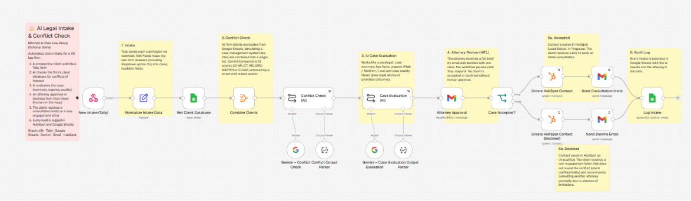
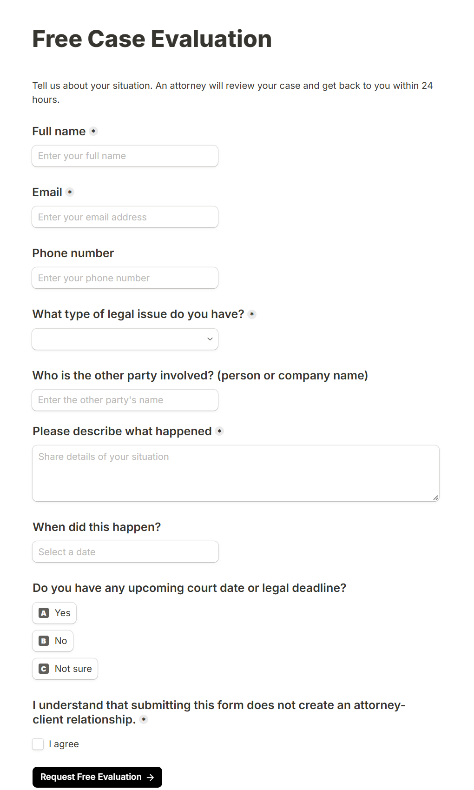
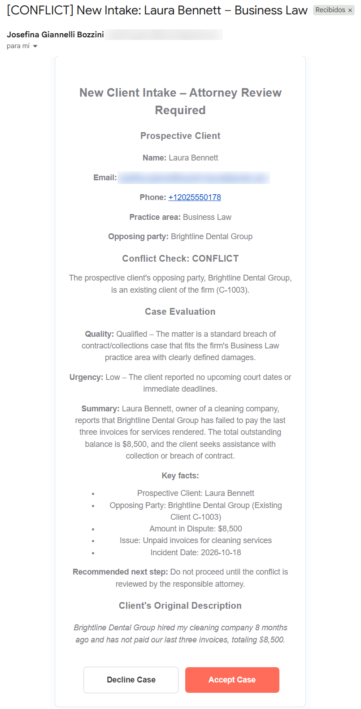
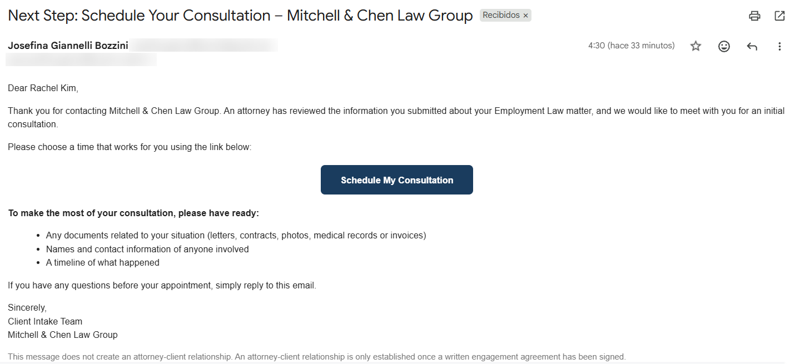
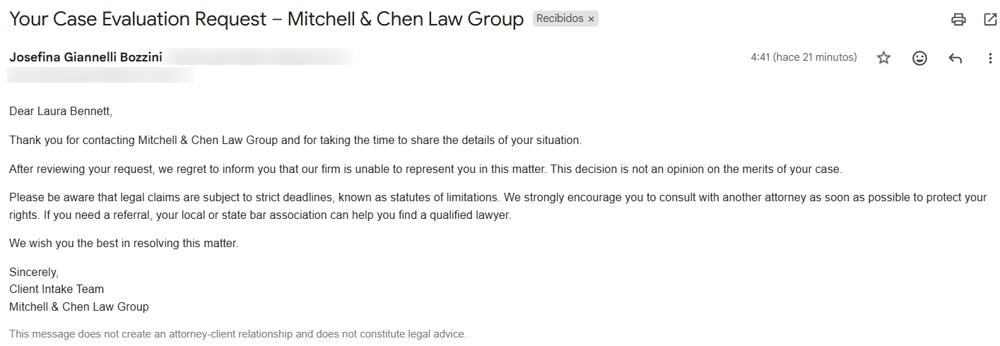
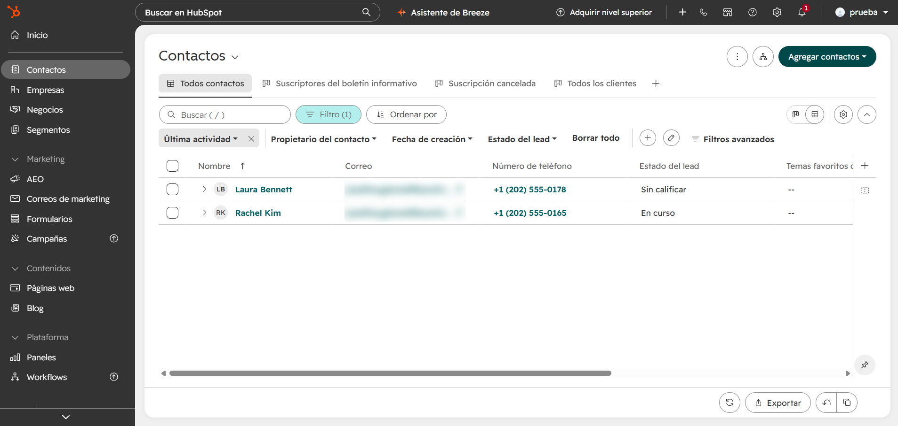
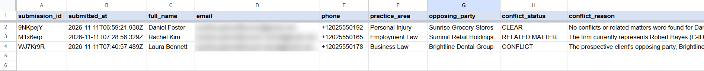
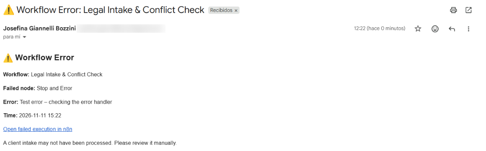

# ⚖️ AI Legal Intake & Conflict Check

An n8n automation that handles client intake for a US law firm: it checks every new inquiry for conflicts of interest, has AI prepare a case evaluation, and lets an attorney accept or decline the case with one click from their inbox.

> **Demo project.** *Mitchell & Chen Law Group* is a fictional firm and all client data is simulated.



## 🎬 Demo

VIDEO_PLACEHOLDER

---

## The problem

Law firms lose potential clients when they take hours or days to respond to new inquiries. Before accepting any case, they must also run a **conflict-of-interest check** to make sure they don't already represent the other party. In many firms this check is still done manually.

## The solution

1. A prospective client fills out a **Tally** form on the firm's website.
2. The workflow loads the firm's client database and **AI runs the conflict check** against it.
3. **AI evaluates the case** like a paralegal would: summary, key facts, urgency and case quality.
4. The attorney receives a **full brief by email** and clicks **Accept Case** or **Decline Case**.
5. **Accepted:** the contact is created in HubSpot and the client receives a link to book a consultation.
6. **Declined:** the contact is saved in HubSpot as *Unqualified* and the client receives a non-engagement letter.
7. Every intake is recorded in an **audit log** in Google Sheets.

## Conflict check results

| Result | When | Example |
|---|---|---|
| 🔴 **CONFLICT** | The opposing party is a client of the firm, or the prospect is the opposing party in one of the firm's matters | Laura Bennett wants to sue Brightline Dental Group, an existing client |
| 🟡 **RELATED MATTER** | The firm already represents someone else against the same party (same side, needs review) | Rachel Kim vs. Summit Retail Holdings, where the firm already represents Robert Hayes |
| 🟢 **CLEAR** | No matches in the client database | Daniel Foster vs. Sunrise Grocery Stores |

---

## Workflow

| Step | Node | What it does |
|---|---|---|
| 1 | **New Intake (Tally)** | Webhook that receives each form submission |
| 2 | **Normalize Intake Data** | Edit Fields node that turns raw Tally answers (including dropdown option IDs) into clean fields, with no Code node |
| 3 | **Get Client Database** | Reads the firm's clients from Google Sheets (simulating a case management system like Clio) |
| 4 | **Combine Clients** | Aggregate node that merges all rows into one list, so the AI runs once instead of once per client |
| 5 | **Conflict Check (AI)** | Gemini (temperature 0) returns `CONFLICT`, `RELATED MATTER` or `CLEAR` through a Structured Output Parser |
| 6 | **Case Evaluation (AI)** | Gemini returns a case summary, key facts, urgency (High / Medium / Low), case quality and a recommended next step |
| 7 | **Attorney Approval** | Gmail *Send and Wait for Response*: the workflow pauses until the attorney clicks Accept or Decline |
| 8 | **Case Accepted?** | If node that routes the case |
| 9a | **Create HubSpot Contact** → **Send Consultation Invite** | Lead Status *In Progress*, plus an email with a scheduling link (HubSpot Meetings) |
| 9b | **Create HubSpot Contact (Declined)** → **Send Decline Email** | Lead Status *Unqualified*, plus a non-engagement letter |
| 10 | **Log Intake** | Google Sheets *Append or Update* keyed on `submission_id` |

---

## Error handling

The workflow is built so that no client inquiry gets lost:

- **Automatic retries.** Every step that calls an external service (Gemini, HubSpot, Gmail, Google Sheets) retries up to 3 times, 5 seconds apart. *Attorney Approval* is the only exception, so the attorney never gets a duplicate email.
- **Error workflow.** If a step still fails, a separate workflow (`Legal Intake – Error Handler`) starts automatically. It emails an alert to the admin and records the failure in an **Error Log** tab, with the failed node, the error message and a link to the execution.
- **No duplicates.** The intake log updates the existing row when an execution runs twice, and HubSpot contacts are matched by email.

```
Error Trigger → Alert Admin (Gmail) → Log Error (Google Sheets)
```

---

## Design decisions

- **Human-in-the-loop.** The AI never accepts or declines a client. It prepares the information and the attorney decides.
- **Client confidentiality.** The decline email never mentions the conflict, because that would reveal that the other party is a client of the firm.
- **Legally careful wording.** Emails state that no attorney-client relationship exists until an engagement agreement is signed. Declined prospects are reminded about statutes of limitations.
- **Deterministic AI.** Temperature 0 and structured output parsers make the AI answer the same way every time, in a fixed format.
- **Idempotent logging.** The log uses `submission_id` as a unique key, so re-running an execution updates the existing row instead of creating duplicates. HubSpot contacts are matched by email for the same reason.
- **Low-code.** The workflow uses no Code nodes. Data is mapped with Edit Fields and expressions.
- **CRM for every lead.** Declined inquiries are also stored in HubSpot, so the firm can track how many cases it turns down and why.

---

## Screenshots

**Intake form (Tally)**


**Attorney review email with one-click decision**


**Consultation invite (accepted)**


**Non-engagement letter (declined)**


**Leads in HubSpot**


**Audit log in Google Sheets**


**Error alert sent by the error handler**


---

## Tech stack

`n8n` · `Tally` · `Google Sheets` · `Google Gemini` · `Gmail` · `HubSpot CRM` · `HubSpot Meetings`

## Workflow files

The `workflows` folder contains:

- `legal-intake-conflict-check.json`: the main workflow
- `legal-intake-error-handler.json`: the error handling workflow

---

## About me

I'm **Josefina Giannelli Bozzini**, an AI Automation Specialist with a background in legal and customer operations. I worked as a Legal Assistant at a law firm, so I built this workflow around problems I saw firsthand: slow responses to new inquiries and manual conflict checks.

[LinkedIn](https://www.linkedin.com/in/josefina-giannelli-bozzini) · [GitHub](https://github.com/josefinagiannellibozzini-777)
