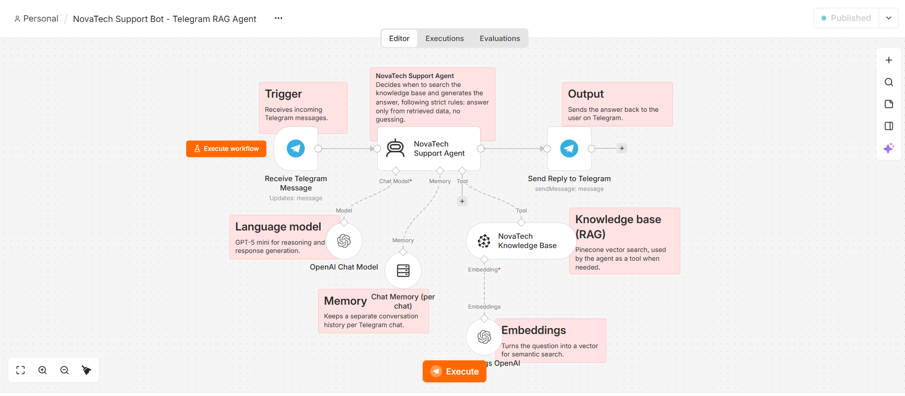
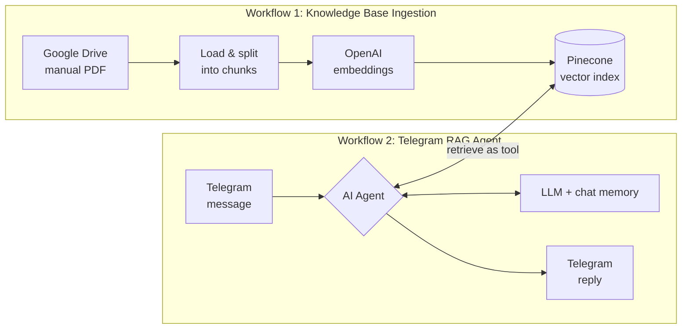
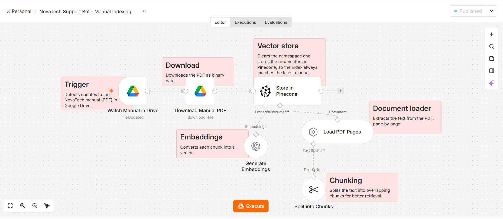

# NovaTech Support Bot: RAG Agent on Telegram

An AI support assistant for a fictional EdTech academy (**NovaTech Academy**), built with **n8n**. It answers student questions on Telegram using only the information in the academy's manual, and it never invents answers.

The project is made of two workflows:

1. **Knowledge Base Ingestion**: turns the manual (PDF in Google Drive) into searchable vectors in Pinecone.
2. **Telegram RAG Agent**: receives questions, retrieves the relevant content and replies.



---

## What it does

- Answers questions about courses, syllabus, prices, enrollment, refunds and policies.
- Replies **only from retrieved data**. If the answer isn't in the manual, it says so and refers the user to the team.
- Replies in the **same language** as the user, in short plain-text messages that read well on a phone.
- Keeps a **separate conversation history per user**, so follow-up questions work.
- Stays up to date: when the manual changes in Drive, the index is rebuilt automatically.

## Architecture



## Workflow 1: Knowledge Base Ingestion



| Step | Node | Purpose |
|---|---|---|
| 1 | Watch Manual in Drive | Detects updates to the manual PDF in Google Drive (polls every minute) |
| 2 | Download Manual PDF | Downloads the file as binary data |
| 3 | Load PDF Pages | Extracts the text page by page |
| 4 | Split into Chunks | Recursive character splitter with a 200-character overlap |
| 5 | Generate Embeddings | Converts each chunk into a vector (OpenAI) |
| 6 | Store in Pinecone | Inserts the vectors, clearing the namespace first so the index always matches the latest manual |

## Workflow 2: Telegram RAG Agent

| Step | Node | Purpose |
|---|---|---|
| 1 | Receive Telegram Message | Triggers on every incoming message |
| 2 | NovaTech Support Agent | Decides when to search the knowledge base and writes the answer |
| 3 | OpenAI Chat Model | GPT-5 mini for reasoning and response generation |
| 4 | Chat Memory (per chat) | Window buffer memory keyed by Telegram chat ID |
| 5 | NovaTech Knowledge Base | Pinecone vector search exposed to the agent as a tool (top 15 chunks) |
| 6 | Embeddings OpenAI | Converts the question into a vector for semantic search |
| 7 | Send Reply to Telegram | Sends the answer to the chat that started the conversation |

## Design decisions

- **Retrieve-as-tool instead of a fixed retrieval step.** The agent searches only when the question needs it, so greetings and off-topic messages don't trigger a vector query.
- **Grounded answers.** Both the system message and the tool description instruct the agent to rely strictly on retrieved results and to admit when it doesn't know.
- **Per-user memory.** The chat ID is used as the session key, so conversations from different users never mix.
- **Chunk overlap.** A 200-character overlap prevents an idea that falls on a chunk boundary from being lost.
- **Clean re-indexing.** Clearing the namespace on each run avoids duplicated or outdated vectors when the manual is updated.
- **Mobile-first replies.** The system message limits answers to a few sentences in plain text, since Telegram clients don't render the agent's Markdown reliably.

## Tech stack

- [n8n](https://n8n.io): workflow automation and AI agent orchestration
- OpenAI: chat model (GPT-5 mini) and embeddings
- [Pinecone](https://www.pinecone.io): vector database
- Telegram Bot API: user interface
- Google Drive: source of the manual

## Setup

1. **Import the workflows** into n8n (`Import from file`):
   - `workflows/knowledge-base-ingestion.json`
   - `workflows/telegram-support-agent.json`
2. **Create the credentials** in n8n: OpenAI, Pinecone, Google Drive (OAuth2) and Telegram (bot token from [@BotFather](https://t.me/BotFather)).
3. **Create a Pinecone index** whose dimensions match the embedding model you use. Both workflows must use the **same index, namespace and embedding model**.
4. **Upload the manual** to Google Drive and select it in the *Watch Manual in Drive* and *Download Manual PDF* nodes.
5. **Run the ingestion workflow** once to populate the index.
6. **Activate the Telegram workflow** and send a message to your bot.

## Repository structure

```
.
├── README.md
├── workflows/
│   ├── knowledge-base-ingestion.json
│   └── telegram-support-agent.json
└── images/
    ├── telegram-agent.png
    └── ingestion.png
```

## Possible improvements

- Add a fallback that logs unanswered questions so the manual can be improved.
- Extend ingestion to multiple documents instead of a single file.
- Add basic evaluation: a set of test questions with expected answers.

## Author

**Josefina Giannelli Bozzini**: AI Automation
[LinkedIn](www.linkedin.com/in/josefina-giannelli-bozzini) 
