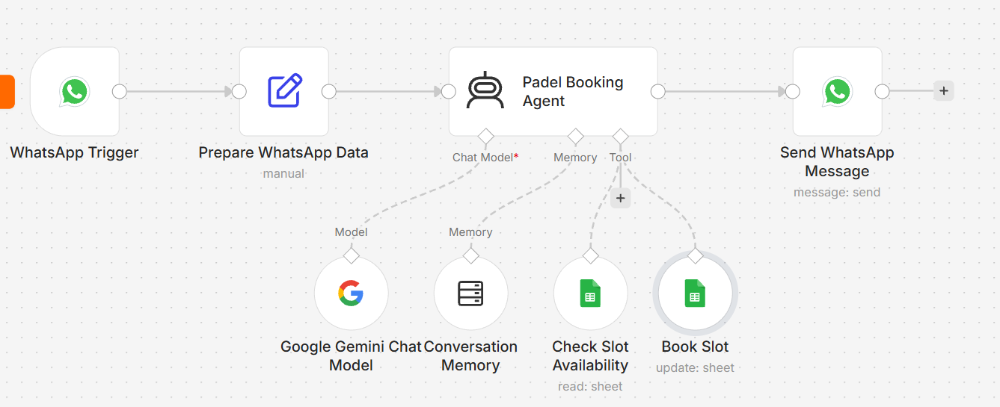

# 🎾 AI Padel Booking Assistant

An AI-powered WhatsApp booking assistant built with **n8n**, **Google Gemini**, and **Google Sheets**.

Customers chat with the assistant on WhatsApp in natural language to check court availability and book time slots. The AI agent reads and updates a Google Sheet that works as the booking database, replacing a manual, paper-based booking process.

## 🎥 Video Demo

Watch the end-to-end demonstration: 👉 [AI WhatsApp Booking Assistant – Demo](https://drive.google.com/file/d/1iOFaWHgUWeh52ygoKRYbp59OP4TKmIiD/view?usp=sharing)

## ⚙️ How It Works

1. **WhatsApp Trigger** receives the customer's message through the Meta WhatsApp Cloud API.
2. **Prepare WhatsApp Data** extracts the customer's name, phone number, and message text.
3. **Padel Booking Agent** (AI Agent powered by Google Gemini) interprets the request and decides which tool to use:
   - **Check Slot Availability** reads the slots sheet.
   - **Book Slot** marks the requested slot as booked and saves the customer's name.
4. **Conversation Memory** keeps the context of the last messages for each customer, using their phone number as the session key.
5. **Send WhatsApp Message** sends the agent's reply back to the customer.

## ✨ Key Features

- **Natural-language booking:** customers can write freely (e.g. *"I want to book Monday at 9am"*) and the agent understands the request. Replies are in Spanish.
- **Availability-first logic:** the agent always checks availability before booking and offers alternative slots when the requested one is taken.
- **No hallucinated data:** the system prompt forbids inventing availability, dates, bookings, or business information.
- **Date awareness:** the current date and weekday are injected into the prompt, so expressions like *"today"*, *"tomorrow"*, or *"Monday"* are resolved against the real calendar.
- **Per-customer memory:** each phone number has its own conversation history.
- **Argentine phone number normalization:** WhatsApp delivers Argentine mobile numbers with a `549` prefix, while Meta's allowed-recipient list stores them as `54`. The reply node normalizes the number so messages are delivered correctly.

## 📊 Google Sheet Structure

Sheet: `slots` — one row per one-hour slot (sample data is fictional).

| Column | Description | Example |
| --- | --- | --- |
| `slot_id` | Unique slot identifier, used to match updates | `mon-8am` |
| `day` | Day of the week | `Monday` |
| `time` | Slot start time | `8:00 AM` |
| `status` | Slot status | `Available` / `Booked` |
| `booked_by` | Customer name (filled when booked) | `Josefina` |

## 🛠️ Tech Stack

- **Automation:** n8n Cloud
- **AI Model:** Google Gemini (via n8n AI Agent)
- **Database:** Google Sheets
- **Messaging:** Meta WhatsApp Cloud API

## 📂 Repository Contents

- `workflows/padel-booking-assistant.json` — Exported n8n workflow.
- `images/` — Workflow screenshots.

## 🚀 Setup

1. Import `padel-booking-assistant.json` into your n8n instance.
2. Connect your own credentials:
   - **WhatsApp Trigger** and **Send WhatsApp Message** → Meta WhatsApp Cloud API (and update the sender Phone Number ID).
   - **Google Gemini Chat Model** → Google Gemini API key (the original workflow used n8n Cloud's built-in AI credits).
   - **Check Slot Availability** and **Book Slot** → Google Sheets, pointing to a sheet with the structure above.
3. Configure the webhook URL from the WhatsApp Trigger in your Meta app and subscribe to the `messages` field.
4. Activate the workflow.

## ⚠️ Limitations & Production Notes

- **Meta app publishing:** this demo runs on Meta's WhatsApp test number. Unpublished Meta apps only receive test webhooks sent from the app dashboard, not real messages. Moving to production requires publishing the app, which involves Meta Business Verification with the business's own legal documents. In a real deployment, this verification would be completed by the client's business.
- **Text messages only:** the workflow expects text messages. Audio, images, or message status updates are not filtered yet and may cause failed executions.
- **No cancellations yet:** customers can book but not cancel through the assistant.
- **Prototype scope:** this project was built as a portfolio prototype with fictional data.

## 🔮 Possible Improvements

- Add a filter after the trigger to process only incoming text messages.
- Add a **Cancel booking** tool, allowed only when the customer's phone number matches the booking.
- Add a **human handoff** option for requests the agent can't resolve.
- Store the customer's phone number in the sheet for traceability.
