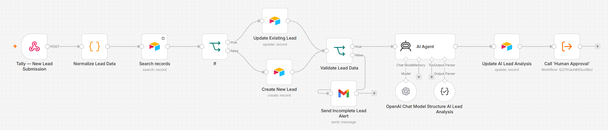
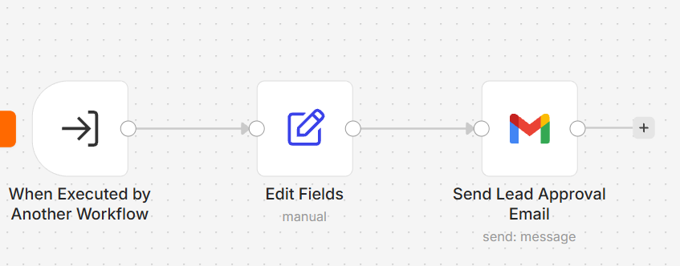
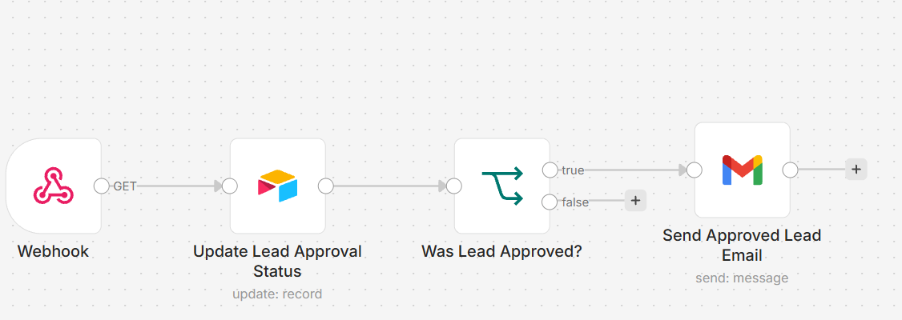
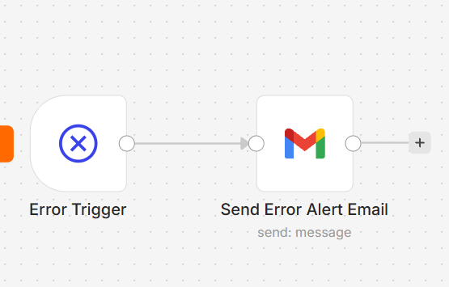
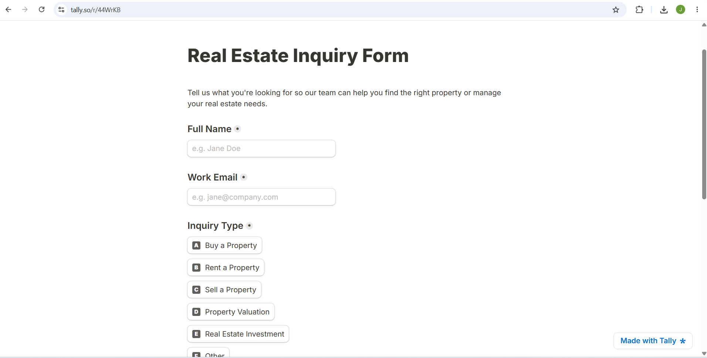
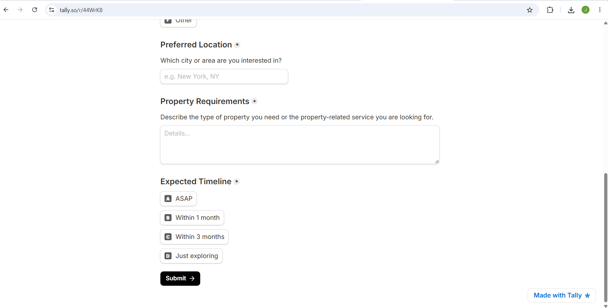
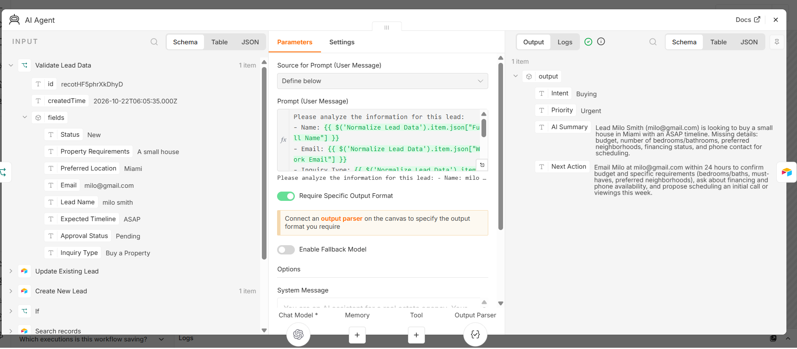
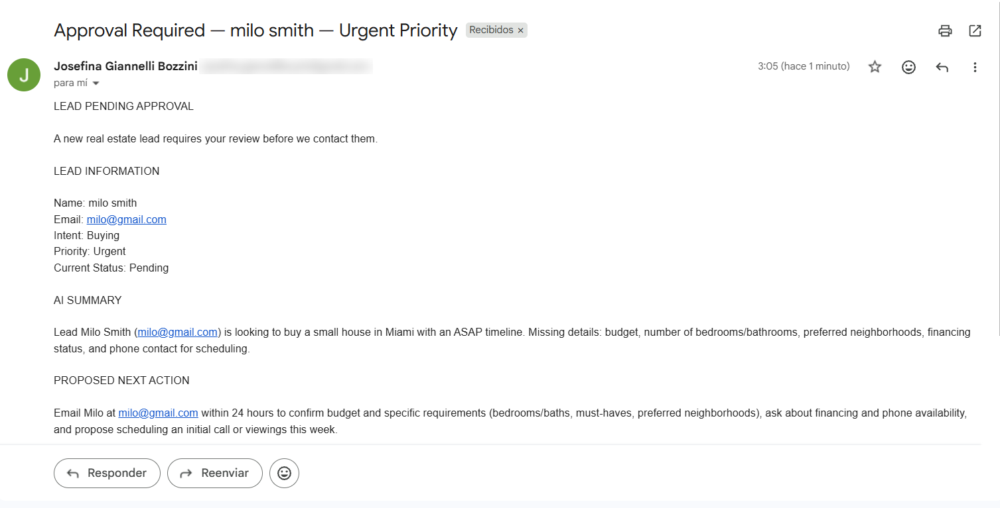
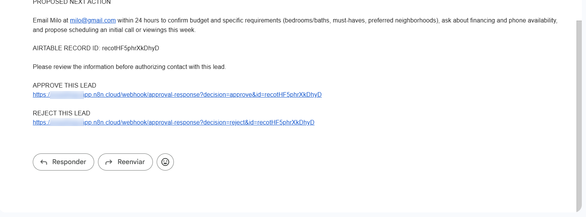

# 🏢 AI-Powered Real Estate Lead Management System

An end-to-end real estate lead management automation built with **n8n, OpenAI, Tally, Airtable, and Gmail**.



## 🚀 Overview

This project automates the intake, qualification, and initial follow-up of real estate inquiries, reducing manual data entry and helping reviewers prioritize potential customers.

### How it works

1. **Lead Capture:** A Tally web form sends each inquiry to an n8n webhook.
2. **Data Normalization:** A Code node extracts and standardizes the submitted fields.
3. **Duplicate Detection:** Airtable is searched by email to decide whether to update an existing lead or create a new one.
4. **Data Validation:** Required fields are checked. Incomplete leads trigger an internal alert email instead of continuing.
5. **AI-Powered Lead Analysis:** An AI Agent (OpenAI + Structured Output Parser) classifies intent, assigns priority, summarizes requirements, and recommends a next action.
6. **CRM Synchronization:** The AI insights are written back to the Airtable record.
7. **Human-in-the-Loop Approval:** A subworkflow emails a reviewer with Approve / Reject links.
8. **Conditional Follow-up:** A webhook receives the decision, updates Airtable, and emails the customer only if the lead was approved.
9. **Error Handling:** A dedicated error workflow emails an alert whenever any of the workflows fails.

## 🧩 Architecture

The system is split into four n8n workflows:

| Workflow | Role |
|---|---|
| **AI Lead Management System** | Main flow: intake, deduplication, validation, AI analysis, CRM sync |
| **Human Approval** | Subworkflow that sends the approval request email |
| **Approval Response** | Webhook that processes the reviewer's decision and sends the follow-up |
| **Error Handler** | Error workflow assigned to the others; sends failure alerts |





## 🛠️ Tech Stack

- **Automation:** n8n Cloud
- **Form Interface:** Tally
- **Database / CRM:** Airtable
- **AI Engine:** OpenAI
- **Communication:** Gmail
- **Integration:** Webhooks and n8n subworkflows

## 📝 Lead Capture Form




## 🤖 AI-Generated Insights

For each lead, the AI returns structured output with four fields:

- **Intent:** Classification of the customer's inquiry.
- **Priority:** Lead priority based on the inquiry and expected timeline.
- **AI Summary:** A concise summary of the customer's requirements.
- **Next Action:** A recommended follow-up action.

The AI is instructed to use only the submitted information and avoid inventing missing details.



## 👤 Human-in-the-Loop

Human approval is required before any follow-up email reaches a customer.

- **Approve:** Updates the lead's approval status and sends the customer follow-up email.
- **Reject:** Updates the approval status without contacting the customer.




## 📊 Airtable CRM

The CRM stores contact information, property requirements, lead status, AI-generated insights, and approval status.

Key fields: `Lead Name`, `Email`, `Inquiry Type`, `Preferred Location`, `Property Requirements`, `Expected Timeline`, `Intent`, `Priority`, `AI Summary`, `Next Action`, `Status`, `Approval Status`.

## 📂 Folder Contents

```
real-estate-lead-management/
├── README.md
├── images/
└── workflows/
    ├── ai-lead-management-system.json
    ├── human-approval.json
    ├── approval-response.json
    └── error-handler.json
```

## ⚙️ Setup

1. Import the four workflow JSON files into your n8n instance.
2. Configure credentials for Airtable, OpenAI, and Gmail.
3. Create an Airtable table with the fields listed above and select it in the Airtable nodes.
4. In the Tally form, add the production webhook URL of the main workflow.
5. In **Human Approval**, replace `YOUR-N8N-INSTANCE` in the approval links with your n8n instance URL, and set the reviewer email.
6. Set `your-email@example.com` in the alert nodes to your own address.
7. Assign **Error Handler** as the error workflow in the settings of the other three workflows.
8. Test the complete process before activating the workflows.

**Security:** No API keys, tokens, or credentials are included in this repository. Email addresses and instance URLs have been replaced with placeholders.

## 🎥 Video Demo

Watch the full end-to-end demo: [View Video on Google Drive] https://drive.google.com/file/d/1SzHyMG1bXJ9whanjse7Gj05ciwK8gwCg/view?usp=sharing

## 📌 Disclaimer

This is a portfolio project demonstrating AI integration, workflow automation, CRM operations, and human-in-the-loop approval. It uses test data and is not affiliated with any real estate company.
