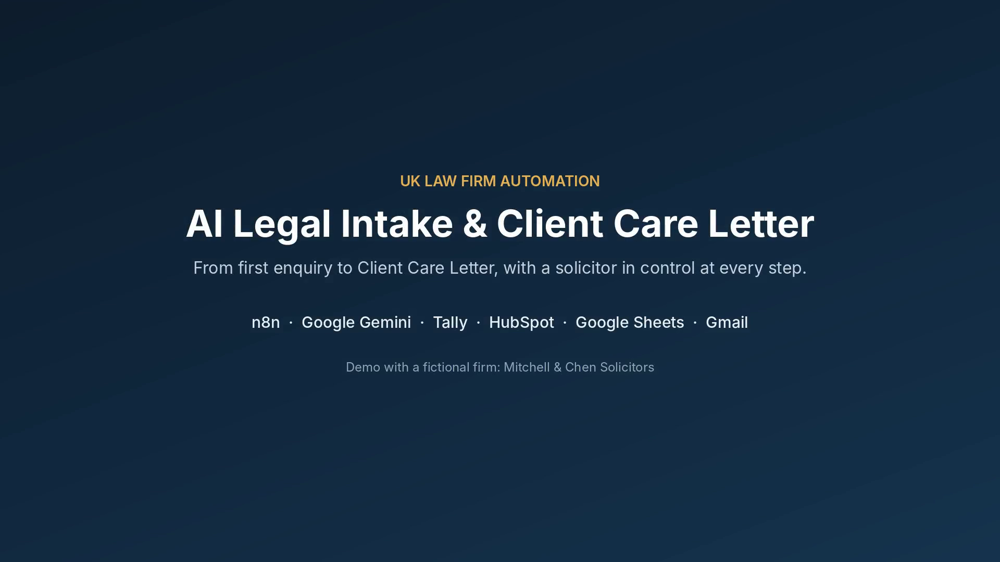
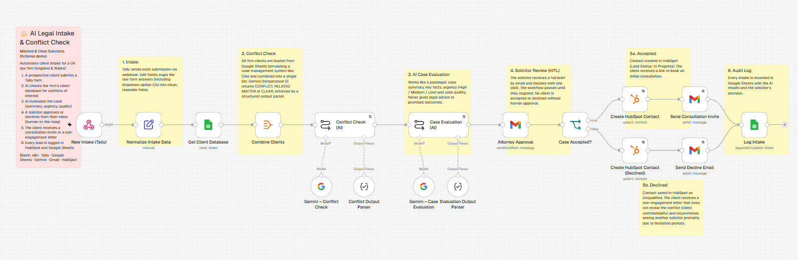
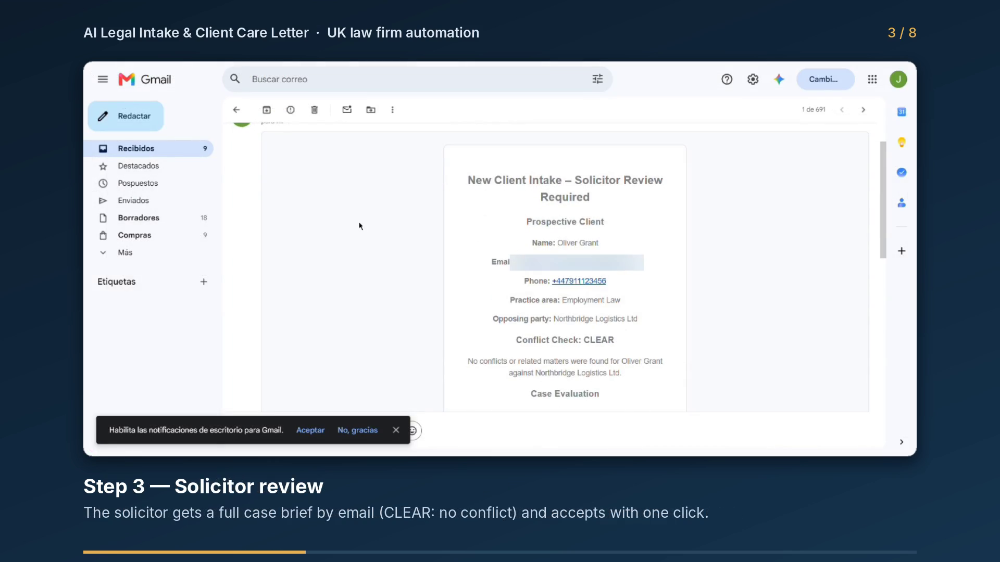
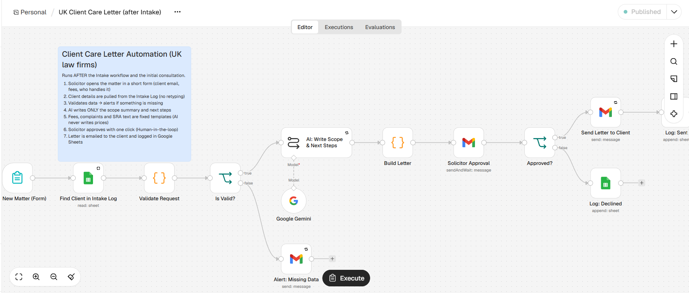
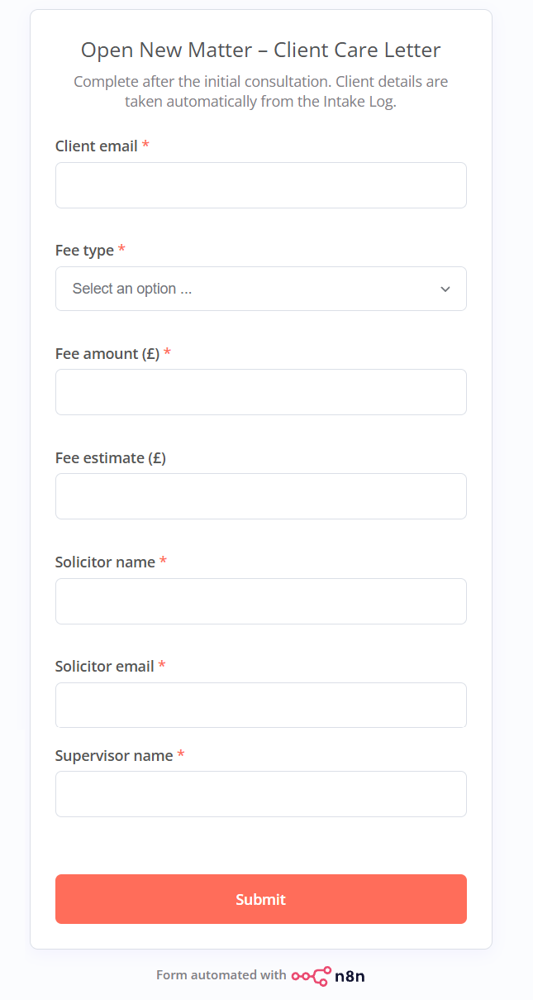
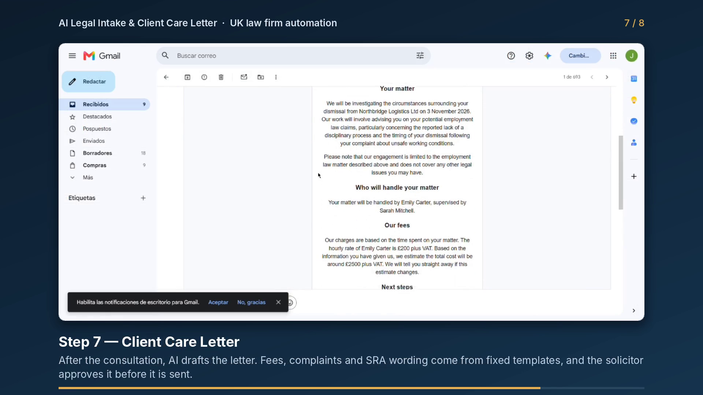
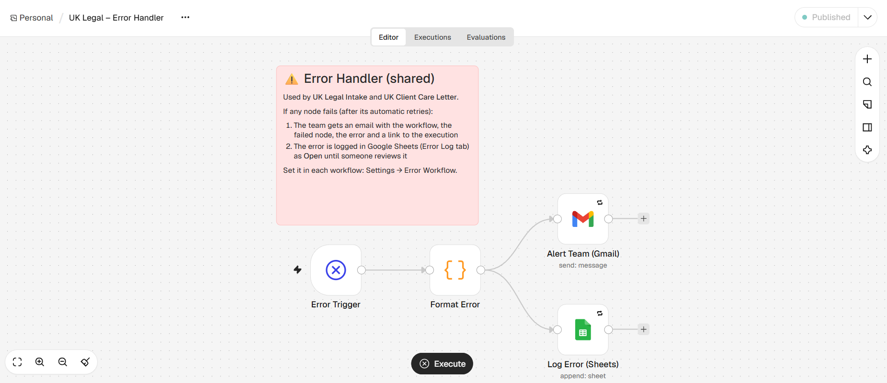

# ⚖️ AI Legal Intake, Conflict Check & Client Care Letter — UK Law Firms

An end-to-end automation for a law firm in England & Wales, built with **n8n**. It takes a prospective client from their first online enquiry to a signed-off **Client Care Letter**, with a solicitor approving every key decision.

> **Demo project.** "Mitchell & Chen Solicitors" is a fictional firm, and all clients and cases are test data. Nothing here is legal advice.

## 🎥 Demo video

[▶️ Watch the 1-minute demo](https://drive.google.com/file/d/1ryQE05HFwn3VLweZoAONkBYVY3zTIoVx/view?usp=sharing): a full run from the intake form to the delivered Client Care Letter. Personal data is blurred.

---

## The problem

Small law firms lose hours on repetitive admin before they even start legal work:

- reading every enquiry and deciding if it is worth a consultation,
- checking for **conflicts of interest** by hand,
- re-typing client details into a CRM and spreadsheets,
- writing a **Client Care Letter** (required by the SRA) for every new matter.

## The solution

Three connected n8n workflows:

| # | Workflow | What it does |
|---|----------|--------------|
| 1 | **UK Legal Intake & Conflict Check** | Receives the enquiry, checks conflicts, evaluates the case with AI, and asks the solicitor to accept or decline |
| 2 | **UK Client Care Letter** | After the consultation, drafts the Client Care Letter, gets solicitor approval and sends it |
| 3 | **UK Legal – Error Handler** | Shared error workflow: alerts the team and logs every failure |

```mermaid
flowchart LR
    A[Tally intake form] --> B[Normalise data]
    B --> C[Load client database<br/>Google Sheets]
    C --> D[AI conflict check<br/>Gemini]
    D --> E[AI case evaluation<br/>Gemini]
    E --> F{Solicitor review<br/>email · one click}
    F -- Accept --> G[HubSpot contact<br/>In Progress]
    G --> H[Consultation invite]
    F -- Decline --> I[HubSpot contact<br/>Unqualified]
    I --> J[Non-engagement letter]
    H --> K[(Intake Log)]
    J --> K
    K -. after consultation .-> L[Open New Matter form<br/>fees + solicitor]
    L --> M[Find ACCEPTED client<br/>in Intake Log]
    M --> N[AI drafts scope<br/>and next steps]
    N --> O[Build letter<br/>fixed fees · complaints · SRA]
    O --> P{Solicitor approval}
    P -- Approve --> Q[Send letter to client]
    Q --> R[(Letters Log)]
    P -- Decline --> R
```

---

## Workflow 1 — Intake & Conflict Check

1. **Intake:** a prospective client submits a Tally form (name, contact, practice area, opposing party, description, dates, UK GDPR consent).
2. **Conflict check:** all firm clients are loaded from Google Sheets (simulating a case management system like Clio or LEAP). Gemini, at temperature 0 with a structured output parser, returns **CONFLICT**, **RELATED MATTER** or **CLEAR**.
3. **AI case evaluation:** a case summary, key facts, urgency (High / Medium / Low) and case quality, written like a paralegal brief. It never gives legal advice.
4. **Solicitor review (human-in-the-loop):** the solicitor gets the full brief by email and clicks **Accept Case** or **Decline Case**. The workflow waits for the decision.
5. **Accepted:** the contact is created in HubSpot as *In Progress*, and the client gets a consultation booking email.
   **Declined:** the contact is saved as *Unqualified*, and the client gets a non-engagement letter. The letter **does not reveal the conflict** (client confidentiality) and warns about **limitation periods**, pointing to the Law Society's *Find a Solicitor* service.
6. **Audit log:** every enquiry is written to Google Sheets with the AI results and the solicitor's decision.

## Workflow 2 — Client Care Letter

1. After the consultation, the solicitor fills in a short **n8n form**: client email, fee type (hourly or fixed), amount, estimate, solicitor and supervisor.
2. The workflow pulls the client's details from the **Intake Log**, but **only if the case was Accepted**, so nothing is typed twice.
3. **Validation:** if data is missing or there is no accepted intake, the solicitor gets an alert and no letter is created.
4. **AI writes only the personalised parts:** the scope of work, what is out of scope, and next steps.
5. **Fees, complaints procedure (Legal Ombudsman) and SRA regulation text are fixed templates.** The AI never writes prices or regulatory wording.
6. The solicitor reviews the full letter and clicks **Approve & Send** or **Decline**.
7. The letter is emailed to the client and logged in Google Sheets.

| Open New Matter form | Letter waiting for approval |
|---|---|
|  |  |

## Workflow 3 — Error Handler

It is set as the **Error Workflow** for both workflows. If any node fails after its automatic retries:

- the team gets an email with the workflow, the failed node, the error, the time (UK) and a link to the execution,
- the error is logged in an **Error Log** sheet with status *Open*.

---

## Reliability and design decisions

- **Human-in-the-loop** at the two decisions that matter: taking on a client, and sending the engagement terms.
- **AI is boxed in.** Temperature 0 and structured output parsers are used for the conflict check and evaluation, and the AI never writes fees or regulatory text.
- **Confidentiality.** Decline emails never mention a conflict.
- **Validation before action.** No letter is created without an accepted intake and valid fees.
- **Retries** on AI, Gmail, HubSpot and Sheets nodes.
- **Central error handling** with email alerts and an error log.
- **Upsert by submission ID** in the Intake Log, so re-runs update the same row and never create duplicates.

## Tech stack

**n8n** · **Google Gemini 2.5 Flash** · **Tally** · **Gmail** (send-and-wait approvals) · **HubSpot CRM** · **Google Sheets**

---

## Setup

### 1. Google Sheets

**Spreadsheet A: client database**

| Tab | Columns |
|-----|---------|
| `Clients` | client_id, client_name, client_email, practice_area, opposing_party, matter_status, responsible_solicitor, opened_date |
| `Intake Log` | submission_id, submitted_at, full_name, email, phone, practice_area, opposing_party, conflict_status, conflict_reason, case_quality, urgency, case_summary, attorney_decision, decided_at |
| `Error Log` | timestamp, workflow, failed_node, error_message, execution_id, execution_url, status |

**Spreadsheet B: letters log**

| Tab | Columns |
|-----|---------|
| `Letters Log` | Ref, Date, Client, Client Email, Matter, Solicitor, Status |

### 2. Tally form (questions in this exact order)

1. Full name · 2. Email · 3. Phone number · 4. Practice area (Personal Injury, Family Law, Employment Law, Commercial Law, Residential Property, Wills & Probate, Other) · 5. Opposing party (optional) · 6. What happened? · 7. Date of the incident (optional) · 8. Upcoming court date or deadline? (Yes / No / Not sure) · 9. If yes, when? (optional) · 10. UK GDPR consent checkbox

Connect it under **Integrations → Webhooks** with the production URL of the `New Intake (Tally)` node.

### 3. Import and configure

1. Import the three JSON files from [`/workflows`](workflows).
2. Add your credentials: Google Sheets, Gmail, Gemini and HubSpot.
3. Replace `YOUR_GOOGLE_SHEET_ID` and `solicitor@example.com` with your own values.
4. In workflows 1 and 2, go to **Settings → Error Workflow** and choose **UK Legal – Error Handler**.
5. Replace `YOUR-SCHEDULING-LINK` in the consultation invite with your booking link.
6. Activate the three workflows.

## Test scenarios

| Scenario | Input | Expected result |
|---|---|---|
| Conflict | Opposing party = an existing client (e.g. *Brightwell Dental Practice Ltd*) | `CONFLICT` and a recommendation not to proceed |
| Clear case | Opposing party not in the database | `CLEAR`, then accept, HubSpot contact and consultation invite |
| Letter | Open New Matter form with the client's email | Letter for solicitor approval, then sent and logged |
| Missing data | Email with no accepted intake | "Client Care Letter NOT generated" alert |
| Failure | Any node error | Error email and an `Open` row in the Error Log |

---

**Built by Josefina Giannelli Bozzini**, AI Automation Specialist (Legal & Customer Operations)
[LinkedIn](https://www.linkedin.com/in/josefina-giannelli-bozzini)
