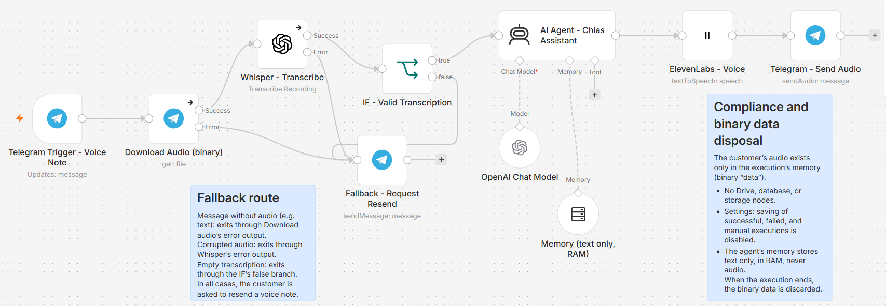

# 🎙️ Voice AI Assistant – Chías Coffee Shop

A voice-to-voice customer assistant built with **n8n**. Customers send a voice note on Telegram and receive a natural-sounding voice reply in seconds, with no customer audio ever stored.

## 🎬 Demo

▶️ [Watch the demo video](https://drive.google.com/file/d/1B3Yrs0RtEcpRlwF9jCAV1dV1NoPP595j/view?usp=sharing)

## 🧩 Workflow

## ⚙️ How it works

1. **Telegram Trigger** receives the customer's message.
2. **Download Audio** fetches the voice note from Telegram as a binary file.
3. **Whisper** transcribes the audio to text.
4. **IF – Valid Transcription** checks that the transcription is not empty.
5. **AI Agent (GPT-4o-mini)** writes a short reply, following rules designed for voice: 200 characters max, plain text only, no links or emojis, and prices and hours written the way they are spoken.
6. **ElevenLabs** converts the reply into a warm, natural voice.
7. **Telegram** sends the audio reply back to the customer.

## 🛡️ Fallback route

The customer always gets an answer, even when something goes wrong:

| Situation | Where it exits | Result |
|---|---|---|
| Text message (no audio) | Download Audio – error output | Asks for a voice note |
| Corrupted audio | Whisper – error output | Asks for a voice note |
| Empty transcription (silence) | IF – false branch | Asks for a voice note |

## 🧠 Conversation memory

The agent remembers the latest messages of each conversation, so customers can ask follow-up questions like *"Do you have cheesecake?"* → *"How much is it?"*. Memory is separated by Telegram chat ID, so conversations never mix, and it stores **text only**.

## 🔒 Privacy by design

- The customer's audio exists only during the execution and is discarded when it ends.
- No Drive, database, or storage nodes.
- Saving of successful, failed, and manual executions is disabled in the workflow settings.
- The ElevenLabs API key uses minimum permissions (text-to-speech only).

## 🤖 Reliable answers

The agent's system prompt includes the coffee shop's information (hours, menu, prices, payment methods) and a strict rule: if something is not in that information, it says it will check instead of making things up.

## 🛠️ Tech stack

`n8n` · `Telegram Bot API` · `OpenAI Whisper` · `GPT-4o-mini` · `ElevenLabs (eleven_multilingual_v2)`

## 🚀 Next steps

- Persistent memory (database) instead of in-memory storage.
- Anonymized transcription log to analyze the most frequent customer questions.
- Error handling for AI service outages.

## 📁 Files

- `workflows/voice-ai-assistant-chias.json` – n8n workflow (import it and add your own credentials)
- `images/workflow.png` – workflow screenshot

---

Built by **Josefina Giannelli Bozzini** · AI Automation Specialist
